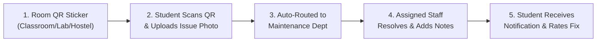
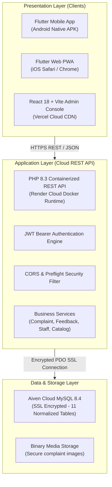
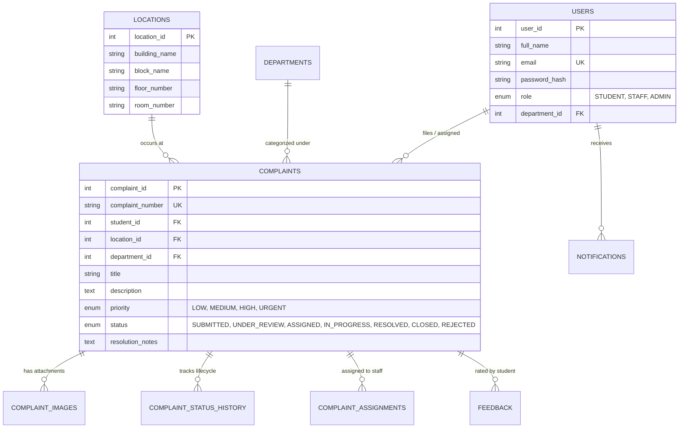

# CampusFix — Complete Project Presentation & Viva Defense Guide

> **Smart Campus Issue Reporting & Resolution Platform**  
> *A QR-Enabled Facility Maintenance & Operations Management System*

---

## Slide 1: Title & Project Overview

### CampusFix: Smart Campus Facility Operations Platform
* **Domain:** Smart Campus / E-Governance / Facilities Management
* **Target Audience:** College Students, Maintenance Staff (Electricians, Plumbers, Housekeeping), and Campus Administrators.
* **Core Value Proposition:** Eliminates physical registers and verbal complaints by introducing instant QR-code room identification, photo proof submission, automated staff assignment, and real-time resolution tracking.

### Live Production Deployments
* **Admin Web Portal:** [campus-fix.vercel.app](https://campus-fix.vercel.app/)
* **Backend REST API:** [campusfix-backend-sdzj.onrender.com](https://campusfix-backend-sdzj.onrender.com)
* **Cloud Database:** Aiven MySQL 8.4 (Asia Pacific Cluster)
* **Android Release APK:** `campusfix-release.apk` (Version 1.0.0)
* **Web App for iPhone / Browsers:** [kajalrajput92.github.io/CampusFix](https://kajalrajput92.github.io/CampusFix/)

---

## Slide 2: Problem Statement & Motivation

### The Traditional Campus Maintenance Problem
In most colleges and universities:
1. **Paper-Based & Verbal Complaints:** Students have to physically visit the maintenance department or write in register notebooks.
2. **Lack of Location Specificity:** Complaints say *"Fan not working in 2nd floor lab"*, leaving staff confused about the exact room or switchboard.
3. **No Accountability or Proof:** Students have no way of knowing whether their issue was received, assigned, or fixed.
4. **Duplicate Spam:** Multiple students report the same broken light, creating redundant work for administrators.
5. **Zero Performance Metrics:** College management has no analytics on average resolution time, pending backlogs, or staff efficiency.

---

## Slide 3: Proposed Solution & Core Innovation

CampusFix replaces manual chaos with a **unified cloud-first digital ecosystem**:

### Key Differentiators:
* **QR-Enabled Room Tagging:** Eliminates manual typing of buildings, blocks, floors, and room numbers.
* **Photo Proof Verification:** Complaints require visual evidence to avoid fake or vague reports.
* **Role-Based Access Control (RBAC):** Strict separation of privileges between Students, Staff, and Admins.
* **Real-time Lifecycle State Machine:** `SUBMITTED` $\rightarrow$ `UNDER_REVIEW` $\rightarrow$ `ASSIGNED` $\rightarrow$ `IN_PROGRESS` $\rightarrow$ `RESOLVED` $\rightarrow$ `CLOSED` (or `REJECTED`).
* **Closed-Loop Feedback:** Students rate the completed work (1–5 stars) with comments, ensuring quality control.

---

## Slide 4: System Architecture

CampusFix is built using a **decoupled 3-tier micro-architecture**:

---

## Slide 5: User Roles & Workflows

### 1. Student Persona
* **Registration & Auth:** Register using college email and secure password.
* **Issue Reporting:** Scan classroom QR code to auto-detect room $\rightarrow$ Select Category (Electrical, Plumbing, Furniture, IT, Cleaning) $\rightarrow$ Attach photo $\rightarrow$ Submit.
* **Tracking:** View live status progression, assigned technician details, and resolution timestamp.
* **Feedback:** Submit a star rating and comment once marked resolved.

### 2. Maintenance Staff Persona
* **Task Queue:** View incoming assigned complaints filtered by priority (`URGENT`, `HIGH`, `MEDIUM`, `LOW`).
* **Issue Diagnosis:** Review student description, room location, and high-resolution photo.
* **Status Updates:** Transition issue to `IN_PROGRESS` $\rightarrow$ `RESOLVED` with technician proof notes.

### 3. Administrator Persona
* **Live Overview:** Real-time KPI cards (Total Complaints, Resolved %, Pending, Active Staff).
* **Complaint Routing:** Assign pending complaints to available department technicians.
* **Campus Locations Management:** Add buildings/rooms and generate printable **QR Code Cards**.
* **Audit & Escalation:** Review priority history, status logs, and student satisfaction ratings.

---

## Slide 6: Backend Architecture & Implementation (PHP 8.3)

The backend (`campusfix-backend/`) is designed with clean OOP principles:

### 1. Architectural Patterns
* **Controller-Service-Model Pattern:**
  * **Controllers** handle HTTP request parsing, status codes, and JSON envelopes.
  * **Services** contain core business logic, validations, duplicate checks, and notification dispatching.
  * **Models** execute parameterized PDO SQL queries against MySQL.
* **Centralized Front Controller (`public/index.php`):**
  * Intercepts all traffic.
  * Handles browser `OPTIONS` preflight requests with `204 No Content`.
  * Enforces dynamic `Access-Control-Allow-Origin` for Vercel, localhost, and tunnels.
  * Catches unhandled exceptions and outputs uniform `{success: false, message: ...}` responses.

### 2. Security & Authentication
* **BCrypt Password Hashing:** All user passwords hashed via `password_hash($pwd, PASSWORD_BCRYPT, ['cost' => 12])`.
* **Stateless JWT (JSON Web Tokens):** Issued upon login containing `sub` (User ID), `role` (`STUDENT`, `STAFF`, `ADMIN`), and expiration.
* **SQL Injection Prevention:** 100% of database queries use PDO prepared statements with strict parameter binding.

---

## Slide 7: Admin Web Console (React 18 + Vite 6)

The admin portal (`campusfix-admin/`) provides a responsive, dark-mode-ready interface:

### 1. Key Technologies
* **React 18:** Functional components with React Hooks (`useState`, `useEffect`, `useCallback`, `useMemo`, `useRef`).
* **Vite 6:** Ultra-fast bundling, HMR, and production tree-shaking.
* **Lucide React:** Clean, consistent SVG iconography.

### 2. Specialized Features Implemented
* **QR Code Generator & Printable Cards:** Generates unique QR cards for every campus room with one-click browser printing (`window.print()`).
* **Protected Binary Image Loading:** Safely fetches authenticated complaint photos via `Blob` and `URL.createObjectURL()`.
* **Smart API Base Fallback:** Development proxy forwards to localhost; production builds automatically target the Render cloud backend.

---

## Slide 8: Mobile Application (Flutter + Dart)

The mobile client (`campusfix-mobile/`) runs on Android, iOS, and Web:

### 1. Architecture
* **Flutter Riverpod 2:** Reactive, compile-safe dependency injection and state management.
* **GoRouter 14:** Declarative deep-linking and state restoration.
* **Dio 5:** Robust HTTP networking with bearer token interceptors and multipart image uploads.
* **Flutter Secure Storage:** Keychain / Keystore hardware-backed token storage.

### 2. QR Code Integration
* **Interactive QR Detection:** Allows instant scanning or code entry (`CAMPUSFIX_LOC:2`).
* **Auto-Fill Logic:** Automatically maps the scanned QR ID to campus buildings, blocks, and room numbers.
* **Deep Link Integration:** Opening `/#/student/complaints/new?location_id=X` automatically pre-selects the room.

---

## Slide 9: Database Schema (11 Normalized Tables)

---

## Slide 10: CI/CD & Cloud Infrastructure

### Continuous Deployment Automation:
1. **GitHub Repository:** Single source of truth at `github.com/kajalrajput92/CampusFix`.
2. **Push to `main` triggers 3 parallel cloud pipelines:**
   * **Vercel Webhook:** Rebuilds React Admin in ~30s with zero downtime.
   * **Render Webhook:** Builds Docker image and deploys PHP REST API in ~90s.
   * **GitHub Actions:** Compiles Flutter Web and deploys PWA to GitHub Pages.

---

## Slide 11: Top 10 Expected Viva / Examiner Questions

### Q1: Why did you choose PHP for the backend instead of Node.js or Django?
> **Answer:** PHP 8.3 provides native OOP features, lightweight memory footprint, and built-in PDO for robust database operations. It allows modular deployment inside minimal Docker containers without heavy runtime overhead.

### Q2: How does the QR code system work technically?
> **Answer:** Each campus room in the `locations` table has a primary key `location_id`. The Admin portal encodes `CAMPUSFIX_LOC:<id>` into a QR code. When the mobile app scans the code, it parses the ID, fetches the location details from the catalog cache, and auto-populates the complaint form.

### Q3: How do you handle authentication securely?
> **Answer:** We use JSON Web Tokens (JWT). Upon successful BCrypt password verification, the server issues a signed HMAC-SHA256 JWT containing the user's ID, role, and expiration timestamp. Subsequent requests transmit this token via the `Authorization: Bearer <token>` header, verified by middleware on protected endpoints.

### Q4: How is duplicate complaint spam prevented?
> **Answer:** When a student files a complaint, `ComplaintService` checks for existing active complaints (`SUBMITTED`, `ASSIGNED`, or `IN_PROGRESS`) sharing the same `location_id` and category within a recent timeframe. If detected, the student is alerted that the issue is already under resolution.

### Q5: How do photos get stored and served securely?
> **Answer:** Photos are uploaded via multipart form data, validated for MIME type (`image/jpeg`, `image/png`, `image/webp`) and size ($\le 5\text{MB}$), stored with sanitized random UUID filenames, and served via an authenticated `/api/complaints/image` endpoint that verifies bearer tokens.

### Q6: Can the mobile app work on iPhones if you built an `.apk`?
> **Answer:** Yes. While `.apk` is native to Android, we compiled the Flutter application to Web (PWA) and deployed it to GitHub Pages. iPhone users can open the web link in Safari and use **Add to Home Screen** to run it with full native-like functionality.

### Q7: What design patterns are used in the codebase?
> **Answer:** 
> * **Backend:** Controller-Service-Repository Pattern, Dependency Injection, Middleware Pattern.
> * **Admin:** Component-Driven Architecture, Custom Hooks, Provider/Context Pattern.
> * **Mobile:** Riverpod Provider Pattern, Repository Pattern, Factory Constructor Pattern for JSON serialization.

### Q8: What database optimizations were implemented?
> **Answer:** All foreign keys (`student_id`, `location_id`, `department_id`, `complaint_id`) have explicit B-tree indexes. High-volume queries utilize `INNER JOIN` / `LEFT JOIN` on indexed keys, and sensitive operations use ACID-compliant database transactions.

### Q9: How are real-time notifications handled?
> **Answer:** An event-driven notification trigger in `ComplaintService` creates records in the `notifications` table whenever a complaint is filed, assigned, or resolved. Both the Admin web and mobile apps poll `/api/notifications` and reflect unread notification counts instantly.

### Q10: What are future improvements for CampusFix?
> **Answer:** 
> 1. AI-based image classification to auto-detect broken items and assign priority.
> 2. WebSocket push notifications via Firebase Cloud Messaging (FCM).
> 3. Native iOS release on Apple TestFlight using a macOS CI runner.
